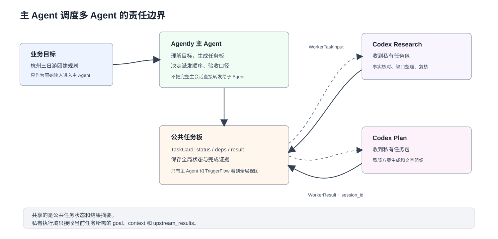
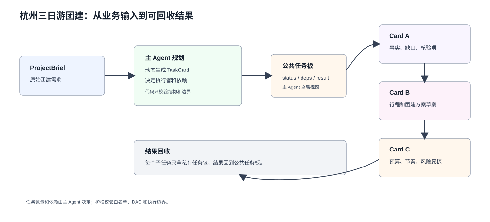
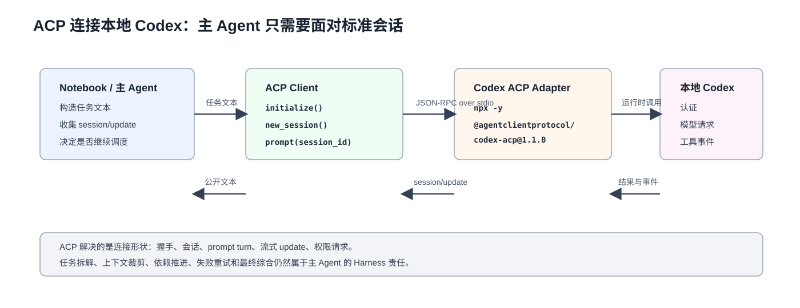
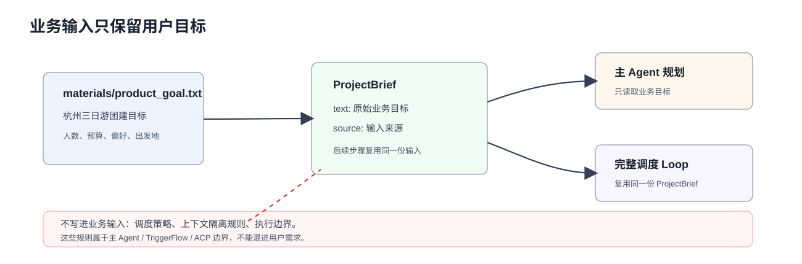
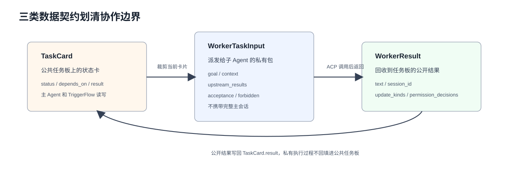
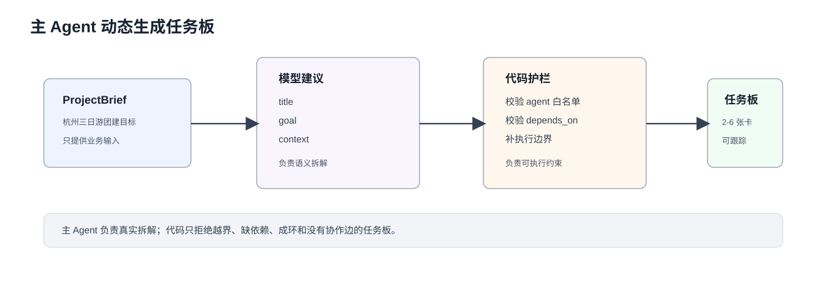
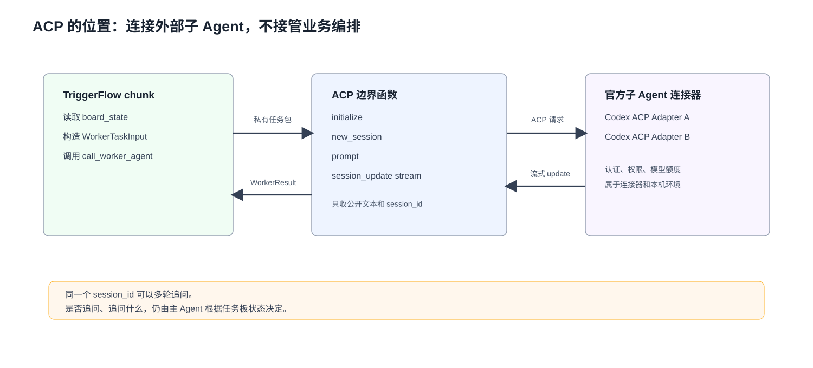
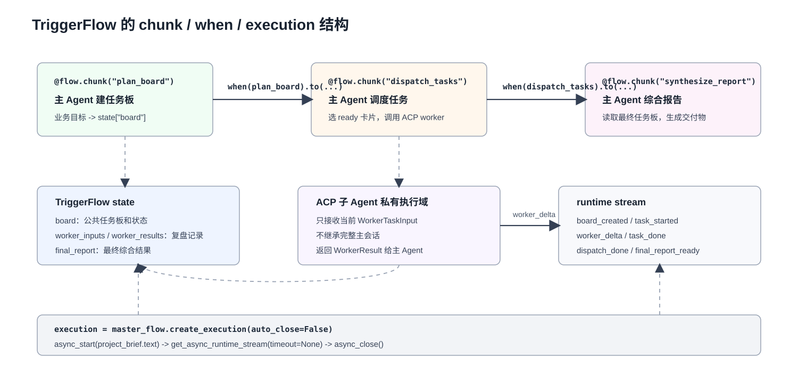
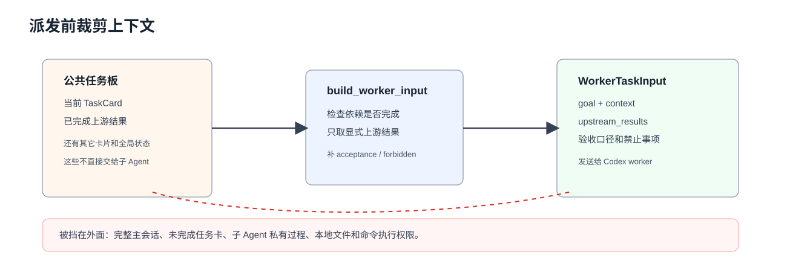

## 主 Agent 调度与多 Agent 协作

多 Agent 协作不是把几个模型连在一起就结束。真正难的地方在主 Agent：它要把目标拆成任务板，决定哪些信息可以共享，哪些信息只能进入某个子 Agent 的私有上下文，还要把结果回收到一个可复盘的全局状态里。

### 学习目标

本文围绕一个问题展开：**主 Agent 怎样调度多个子 Agent，同时避免上下文互相污染？**

读完本文，应当能够：

- 说明多 Agent 协作增加了哪些 Harness 责任；
- 分清公共任务板、私有任务包、子 Agent 结果三类数据；
- 解释 ACP 在这里为什么只是连接边界，不是业务编排层；
- 看懂 ACP 连接本地 Codex 的最小生命周期：启动适配器、初始化、建会话、发送 prompt、接收 update；
- 分清 ACP 和 A2A 的协议边界，以及它们在海外实际落地里的主要场景；
- 用 Agently 生成任务板，用 TriggerFlow state 托管主 Agent Loop；
- 跑通“杭州三日游团建规划”的完整调度、回收和综合流程。


### 阅读方式

理论部分先看主从协作的责任边界，中间单独补一层 ACP 连接知识，再进入完整实战。Notebook 里的变量会留在同一个 kernel 里，后面的 cell 会直接复用前面定义好的 `project_brief`、`runtime_board`、`master_flow` 等对象。

`scripts/` 是课后研究路径，和 Notebook 之间没有依赖关系。Notebook 负责展示核心机制；脚本负责把同一机制拆成可以单独运行的文件。脚本里允许重复定义数据类和 ACP 会话对象，优先保证打开单个文件就能按顺序读懂。


## 第一部分 · 理论：主从 Agent 协作的架构责任

单 Agent 长任务里，很多失败看起来像“上下文不够”或“模型不够强”。换成主从 Agent 以后，问题没有消失，只是变成了更清楚的工程责任：谁保留全局状态，谁看到哪些背景，谁判断结果可不可以进入下一步。

### 1. 单 Agent 长任务的问题不只是上下文长短

一个 Agent 一直循环，最常见的不是“完全不会做”，而是中途开始混乱：一段上下文里有用户目标、工具日志、失败尝试、半成品结论、模型自我解释。后续步骤看到这些内容，很难判断哪些是事实，哪些只是临时推理。

| 问题 | 单 Agent 里的表现 | 主从调度里的处理方式 |
|---|---|---|
| 上下文污染 | 所有中间过程都进入同一条会话 | 子 Agent 只返回公开结果，私有过程不回流 |
| 全局状态发散 | 任务做到哪一步主要靠模型“感觉” | 主 Agent 把状态写进任务板 |
| 完成证据不足 | 子任务说完成，但没有会话、结果和验收记录 | 回收 `session_id`、结果文本和状态变化 |
| 失败边界模糊 | 一个子问题失败后，主会话继续堆信息 | 失败留在具体任务卡上，主 Agent 决定重试或人工确认 |



图 1：共享的是公共任务状态和结果摘要；进入子 Agent 之前，主 Agent 会把任务卡裁剪成私有任务包。

### 2. 两个公开案例给出的边界

**OpenAI Codex：后台任务需要独立环境和可追踪证据。**  OpenAI 在 Codex 发布说明里把 Codex 描述为可以并行处理多个任务的云端软件工程 Agent；每个任务独立运行在隔离环境里，完成后向用户提供变更、终端日志和测试输出等证据。这个案例说明：多任务不是共享一条巨大上下文，而是把任务、环境和证据分开管理。来源：[Introducing Codex](https://openai.com/index/introducing-codex/)。

**Hermes：子 Agent 隔离上下文，Kanban 承载跨 Agent 状态。**  Hermes 的 Subagent Delegation 文档写得很直接：子 Agent 从全新 conversation 开始，只知道父 Agent 放进 `goal` 和 `context` 的内容；Kanban 文档则把多 Agent 协作放到持久任务板里，任务、依赖、评论和结果都成为外部状态。来源：[Subagent Delegation](https://hermes-agent.nousresearch.com/docs/user-guide/features/delegation)、[Kanban](https://hermes-agent.nousresearch.com/docs/user-guide/features/kanban)。

这些案例不能推出“所有任务都应该多 Agent”。它们共同说明的是：一旦拆成多个执行者，系统就要明确状态、上下文、权限和证据的归属。

### 3. 本文采用的主从 Agent 方案

本文的任务板由主 Agent 根据业务目标动态生成：主 Agent 决定几张卡、每张卡叫什么、交给哪个 Codex worker、依赖关系怎么连。宿主代码不补默认任务，也不替模型硬排三段流程；它只做真实系统需要的护栏校验：任务数量范围、子 Agent 白名单、`task_id` 格式、依赖存在性、DAG 无环和至少一条协作依赖边。

| 层 | 负责什么 | 不负责什么 |
|---|---|---|
| 主 Agent | 理解目标、动态生成任务板、回收结果、综合输出 | 不直接执行子任务，也不绕过结构护栏 |
| TriggerFlow | 保存 `board`、暴露阶段事件、关闭执行 | 不替模型做语义规划，也不保存私有推理过程 |
| 公共任务板 | 保存任务状态、依赖、会话证据和最终结果 | 不保存子 Agent 的完整私有过程 |
| 私有任务包 | 给某个子 Agent 的 `goal + context + upstream_results` | 不携带完整主会话和其他无关卡片细节 |
| ACP 边界 | 连接两个官方 Codex ACP worker，收流式 update | 不拆任务、不验收业务结果 |
| 子 Agent | 完成一张任务卡，返回可回收摘要 | 不管理全局计划 |




图 2：杭州三日游团建案例里，主 Agent 先生成任务板，再把每张卡片裁剪成私有任务包，最后回收结果并综合给组织者。

## 第二部分 · ACP 简介：把本地 Agent 接成标准会话

主从 Agent 方案里，主 Agent 不应该知道 Codex、Claude Agent SDK、Gemini CLI 这些运行时各自怎么启动、怎么流式输出、怎么申请权限。它需要的是一个更窄的连接形状：能握手、能建会话、能发 prompt、能收到 update、能保留 `session_id`。



ACP 在这里像一段标准连接线。Codex 仍然在本机运行，认证、模型请求和工具事件仍由 Codex 自己处理；主 Agent 侧只面对 ACP 的 `initialize -> new_session -> prompt -> session/update` 生命周期。


### 4. ACP 只统一连接，不替代主 Agent 编排

换成工程视角，ACP 解决的是“怎么和一个 Agent 说话”，不是“怎么决定让谁做什么”。这点一旦分清，后面的代码就不会混乱：

| 层次 | ACP 负责 | 主 Agent / Harness 负责 |
|---|---|---|
| 连接 | 启动 Agent 进程，完成 `initialize` | 选择要调用哪个 Agent |
| 会话 | 创建 `session_id`，承载一轮或多轮 `prompt` | 决定一个任务卡是否复用同一会话 |
| 输出 | 接收 `session/update`、文本增量、停止原因 | 把公开结果写回任务板 |
| 权限 | 把工具权限请求转给 Client | 采用允许、拒绝、人工审批等策略 |
| 编排 | 不负责 DAG、重试、验收和综合 | 管任务板、依赖、失败边界和最终交付 |

这也是为什么完整实战里主 Agent 仍然要维护 `TaskCard`、`WorkerTaskInput` 和 TriggerFlow state。ACP 只是把本地 Codex 接进来，不会替主 Agent 生成任务板。


### 5. 连接本地 Codex 的最简案例

先看一段最小代码。它只做一件事：启动官方 Codex ACP adapter，建立一个 session，发一轮很短的 prompt，然后打印回收文本和 `session_id`。这段代码不引入任务板，也不做上下文裁剪，目的只是把 ACP 生命周期跑清楚。


```python
# ===== ACP 最简连接：启动官方 Codex adapter，发送一轮 prompt =====
import json
import os
import shutil
from pathlib import Path
from typing import Any, cast

from acp import PROTOCOL_VERSION, Client, spawn_agent_process, text_block
from acp.schema import (
    ClientCapabilities,
    DeniedOutcome,
    Implementation,
    PermissionOption,
    ReadTextFileResponse,
    RequestPermissionResponse,
    ToolCallUpdate,
)

# Notebook kernel 的 PATH 不一定包含 Codex.app 内置命令。
# 这里把 Codex.app 的资源目录补进子进程环境，npx 启动 adapter 时也能找到本地 Codex。
INTRO_LESSON_DIR = Path.cwd()
if not (INTRO_LESSON_DIR / "materials" / "product_goal.txt").is_file():
    INTRO_LESSON_DIR = Path("harness_class/lessons/Multi_Agent_Orchestration").resolve()

INTRO_ACP_ENV = os.environ.copy()
INTRO_CODEX_BIN_DIR = Path("/Applications/Codex.app/Contents/Resources")
if INTRO_CODEX_BIN_DIR.is_dir():
    INTRO_ACP_ENV["PATH"] = f"{INTRO_CODEX_BIN_DIR}:{INTRO_ACP_ENV.get('PATH', '')}"

INTRO_CODEX_SPEC = {
    "name": "codex",
    "command": os.getenv("ACP_NPX_COMMAND", "npx"),
    "args": ("-y", "@agentclientprotocol/codex-acp@1.1.0"),
}

if shutil.which(str(INTRO_CODEX_SPEC["command"]), path=INTRO_ACP_ENV.get("PATH")) is None:
    raise RuntimeError("当前 Notebook kernel 找不到 npx，请从已配置 Node 的 shell 启动 Jupyter kernel。")

print(INTRO_CODEX_SPEC)

```

最小 Client 只做三件事：收文本、拒绝副作用权限、暴露最终文本。这里故意不写复杂封装，后面的完整实战会在这个基础上增加流式转发、任务板回写和多轮会话。


```python
# ===== ACP 最小 Client：收文本，拒绝副作用权限 =====
class IntroCodexClient:
    def __init__(self) -> None:
        self.text_chunks: list[str] = []
        self.update_kinds: list[str] = []

    async def session_update(self, session_id: str, update: Any, **kwargs: Any) -> None:
        update_kind = str(getattr(update, "session_update", ""))
        self.update_kinds.append(update_kind)
        content = getattr(update, "content", None)
        text = getattr(content, "text", None)
        if update_kind == "agent_message_chunk" and getattr(content, "type", None) == "text" and isinstance(text, str):
            self.text_chunks.append(text)

    async def request_permission(
        self,
        options: list[PermissionOption],
        session_id: str,
        tool_call: ToolCallUpdate,
        **kwargs: Any,
    ) -> RequestPermissionResponse:
        # 这个最简案例只验证连接，不允许子 Agent 读写文件或执行命令。
        return RequestPermissionResponse(outcome=DeniedOutcome(outcome="cancelled"))

    async def write_text_file(self, **kwargs: Any) -> None:
        raise RuntimeError("最简 ACP Client 没有声明文件写入能力")

    async def read_text_file(self, **kwargs: Any) -> ReadTextFileResponse:
        raise RuntimeError("最简 ACP Client 没有声明文件读取能力")

    @property
    def text(self) -> str:
        return "".join(self.text_chunks).strip()

```

运行这段代码时，`spawn_agent_process()` 会启动 `npx -y @agentclientprotocol/codex-acp@1.1.0`。`initialize()` 交换协议版本和客户端信息；`new_session()` 生成会话；`prompt()` 把文本任务发给同一个会话。


```python
# ===== ACP 最小运行：initialize -> new_session -> prompt =====
async def run_intro_codex_prompt(prompt_text: str) -> dict[str, object]:
    client = IntroCodexClient()
    command = str(INTRO_CODEX_SPEC["command"])
    args = cast(tuple[str, ...], INTRO_CODEX_SPEC["args"])

    async with spawn_agent_process(
        cast(Client, client),
        command,
        *args,
        cwd=INTRO_LESSON_DIR,
        env=INTRO_ACP_ENV,
    ) as (connection, _process):
        init = await connection.initialize(
            protocol_version=PROTOCOL_VERSION,
            client_capabilities=ClientCapabilities(),
            client_info=Implementation(name="course-acp-intro", title="ACP 简介最小 Client", version="0.1.0"),
        )
        session = await connection.new_session(cwd=str(INTRO_LESSON_DIR), mcp_servers=[])
        response = await connection.prompt(
            prompt=[text_block(prompt_text)],
            session_id=session.session_id,
        )

    agent_info = init.agent_info.name if init.agent_info is not None else "(未提供 agentInfo)"
    return {
        "agent_info": agent_info,
        "session_id": session.session_id,
        "stop_reason": str(response.stop_reason),
        "update_kinds": sorted(set(client.update_kinds)),
        "text": client.text,
    }

intro_codex_result = await run_intro_codex_prompt(
    "只回复 ACP_CODEX_OK。不要读取文件，不要运行命令，不要修改文件。"
)
print(json.dumps(intro_codex_result, ensure_ascii=False, indent=2))

```

**关键观察**：这段最小代码已经具备 ACP 的核心动作，但它还不是多 Agent 协作。它没有任务拆解，没有依赖顺序，没有上下文裁剪，也没有结果验收。后面的完整实战会把这段连接能力放进主 Agent 的任务板调度里。


### 6. Spec dict 示例与验证状态

ACP Registry 里登记了很多可用 Agent，但“有启动形状”不等于“本机已经可用”。`AgentSpec` 只描述主 Agent 怎么启动一个外部执行单元；真实可用还取决于 CLI 是否安装、是否完成登录、是否有模型额度。

先看官方 adapter 或 Registry 里有明确启动形状的 Agent。这类可以写成比较稳定的 `Spec dict` 示例：

| Agent | 来源 | Spec dict 示例 | 课程口径 |
|---|---|---|---|
| Codex | ACP Registry / Codex adapter | `{"name": "codex", "command": "npx", "args": ("-y", "@agentclientprotocol/codex-acp@1.1.0")}` | 已在本课真实跑通 |
| Claude Agent | ACP Registry / Claude adapter | `{"name": "claude_agent", "command": "npx", "args": ("-y", "@agentclientprotocol/claude-agent-acp@0.55.0")}` | 需单独验证登录和额度 |
| Gemini CLI | ACP Registry | `{"name": "gemini", "command": "npx", "args": ("-y", "@google/gemini-cli@0.49.0", "--acp")}` | 需单独验证登录和额度 |
| Qoder CLI | ACP Registry | `{"name": "qoder", "command": "npx", "args": ("-y", "@qoder-ai/qodercli@0.2.14", "--acp")}` | 需单独验证登录和额度 |

还有一些 Agent 支持 ACP，但启动参数依赖具体网关、配置文件、安装方式或运行环境。这里不写成可复制 Spec，只给官方文档入口：

| Agent | 官方文档 | 课程口径 |
|---|---|---|
| OpenClaw | [OpenClaw ACP 文档](https://docs.openclaw.ai/cli/acp) | Gateway-backed bridge，通常需要配置网关地址、token、session 等参数 |
| Hermes Agent | [Hermes ACP 文档](https://hermes-agent.nousresearch.com/docs/user-guide/features/acp) | 支持 `hermes acp`、`hermes-acp`、`python -m acp_adapter` 等方式，按安装方式选择 |
| Cursor | [Cursor ACP 文档](https://cursor.com/docs/cli/acp) | 需要本机安装 Cursor CLI |

本文完整实战只使用两个 Codex profile，是为了让课堂案例可以真实跑通，同时保留“两个独立子 Agent 执行域”的效果。其它 Agent 适合课后按文档逐个接入和验证。


### 7. ACP 和 A2A：服务内调用和跨边界协作不是一回事

同样是“Agent 之间通信”，工程场景其实差很多。

先看本文正在做的事：主 Agent 在同一个服务模块里维护任务板，知道全局目标、依赖关系、上下文裁剪规则和最终验收方式。它只是需要把某张任务卡交给本地 Codex worker 执行，再把结果写回任务板。这个 worker 不需要主动发现别的 Agent，也不需要和 HR、财务、供应商系统协商任务；它只要接收 prompt、输出文本、返回 session/update。

这类场景更像“服务内部的主从调度”。主 Agent 是调度中心，子 Agent 是执行单元。通信要轻、要直接、要容易观察。普通函数、内部 API、消息队列都可以承担服务内模块通信；如果执行单元本身是一个 coding agent 进程，ACP 就很贴合：启动进程、建 session、发 prompt、收流式 update。

A2A 面向的是另一类场景。比如团建任务继续往后推进，可能会出现这些独立系统：

- HR Agent：确认人数、部门、员工偏好和审批规则；
- 财务 Agent：确认预算、报销标准和付款限制；
- 供应商 Agent：提供酒店、餐饮、车辆报价；
- 法务 Agent：检查合同条款和风险边界。

这些 Agent 可能来自不同团队、不同 SaaS、不同供应商，彼此不共享进程、数据库、记忆和工具。它们需要先知道“对方能做什么”，再交换任务、产物和状态，同时保留各自系统边界。A2A 的设计重点更接近这种跨服务、跨团队，甚至公开市场里的 Agent 发现与协作。

| 问题 | 服务模块内主从调度 | 跨服务 / 跨团队 Agent 协作 |
|---|---|---|
| 谁掌握全局任务状态 | 主 Agent / Harness | 多个独立 Agent 各管一部分 |
| 子 Agent 是否需要被公开发现 | 不需要，主 Agent 已经知道调用谁 | 需要，外部 Agent 要能看到能力描述 |
| 通信对象 | 本地 worker、coding agent、内部执行单元 | SaaS Agent、企业系统 Agent、供应商 Agent |
| 关注重点 | 轻量连接、上下文裁剪、流式输出、结果回收 | 能力发现、身份边界、任务协商、产物交换 |
| 更贴近的协议 | ACP 或内部 API / Queue | A2A |

所以本文不用 A2A，不是因为 A2A 没价值，而是因为它不是为这种服务模块内的轻量通讯设计的。把 A2A 放进本文实战，会引入 agent discovery、capability card、远程服务边界、任务协商等概念，反而遮住主线：主 Agent 怎样拆任务、裁剪上下文、调度本地 worker、回收结果。

海外实际落地也基本沿着这个分工展开。ACP 更集中在开发者工具和 coding agent 接入：Zed、JetBrains 通过 Registry 发现和安装 coding agents，Registry 里能看到 Claude Agent、Codex CLI、Gemini CLI、GitHub Copilot、Goose、OpenCode、Qwen Code 等代表项目。A2A 更偏企业协作网络：Google ADK / A2A samples、LangGraph 或 BeeAI agent 暴露成 A2A server，以及 Salesforce、SAP、ServiceNow、Workday、UiPath 这类企业软件或自动化平台围绕跨系统 Agent 协作做互操作。

放回本文案例，选择很清楚：主 Agent 调本地 Codex worker，用 ACP；未来如果要让 HR Agent、财务 Agent、供应商 Agent、法务 Agent 跨系统互相发现能力并交换任务，再考虑 A2A。


## 第三部分 · 实战：用主 Agent 骨架跑通调度 Loop


### 实战 1. 先创建主 Agent 骨架

主 Agent 在这节课里由两部分组成：Agently 负责模型请求，TriggerFlow 负责流程编排和执行状态。先把骨架搭出来，后面的任务板、ACP 和综合报告都挂到这两个对象上。



图 3：业务目标只描述杭州三日游团建本身；调度规则属于主 Agent 代码，不写进用户需求。


```python
# ===== 主 Agent 骨架：模型请求器 + TriggerFlow 编排 =====
import asyncio
import json
import os
import re
import shutil
from dataclasses import asdict, dataclass, replace
from pathlib import Path
from typing import Any, Awaitable, Callable, cast

from agently import Agently, TriggerFlow, TriggerFlowRuntimeData
from dotenv import find_dotenv, load_dotenv

# 步骤 1：定位课程目录。Notebook 可能从课程目录打开，也可能从项目根目录打开。
# 后面的材料、运行产物、图片都基于 LESSON_DIR 定位。
LESSON_DIR = Path.cwd()
if not (LESSON_DIR / "materials" / "product_goal.txt").is_file():
    LESSON_DIR = Path("harness_class/lessons/Multi_Agent_Orchestration").resolve()

GOAL_PATH = LESSON_DIR / "materials" / "product_goal.txt"
RUN_DIR = LESSON_DIR / ".demo_runs" / "multi_agent"
RUN_DIR.mkdir(parents=True, exist_ok=True)

# 步骤 2：配置主 Agent 的模型请求入口。
# Agently 负责模型请求，TriggerFlow 只管流程阶段和状态流转。
load_dotenv(find_dotenv(usecwd=True))
api_key = os.getenv("DEEPSEEK_API_KEY")
if not api_key:
    raise RuntimeError("需要 DEEPSEEK_API_KEY（放在项目根目录 .env 或 shell 导出）。")

Agently.set_settings(
    "OpenAICompatible",
    {
        "base_url": os.getenv("DEEPSEEK_BASE_URL", "https://api.deepseek.com/v1"),
        "model": os.getenv("DEEPSEEK_DEFAULT_MODEL", "deepseek-chat"),
        "model_type": "chat",
        "auth": api_key,
        "request_options": {"temperature": 0},
    },
)

# 步骤 3：把业务输入固定成 ProjectBrief。
# 这个对象只保存“杭州三日游团建需求”，不混入调度规则。
@dataclass(frozen=True)
class ProjectBrief:
    """主 Agent 接收到的原始业务目标。"""

    text: str
    source: str

    def to_dict(self) -> dict[str, str]:
        return {"source": self.source, "text": self.text}

project_brief = ProjectBrief(
    text=GOAL_PATH.read_text(encoding="utf-8").strip(),
    source=str(GOAL_PATH),
)

# 步骤 4：创建主 Agent 骨架。
# master_agent 负责生成任务板和最终报告；master_flow 负责托管状态和执行顺序。
master_agent = Agently.create_agent("hangzhou-team-building-master")
master_flow = TriggerFlow(name="master-agent-board-loop")

print("lesson dir:", LESSON_DIR)
print("project brief preview:")
print(project_brief.text[:260])
```

**关键观察**：这一步还没有 ACP，也没有子 Agent。主 Agent 的第一项责任是拥有一个稳定的“模型请求入口”和一个稳定的“流程状态入口”。

### 实战 2. 定义任务板、私有输入和主 Agent 决策

主 Agent 要管理的不是一段聊天记录，而是一张公共任务板。每张卡片只保存可共享状态；真正发给子 Agent 的内容会裁剪成私有任务包。



图 4：`TaskCard` 是公共状态，`WorkerTaskInput` 是私有输入，`WorkerResult` 是回收结果。

先定义三类数据。`TaskCard` 留在公共任务板上，`WorkerTaskInput` 发给单个子 Agent，`WorkerResult` 是回收到主 Agent 的公开结果。


```python
# ===== 公共任务板、私有任务包、公开回收结果 =====
MAX_ATTEMPTS = 2
ALLOWED_AGENTS = {"codex_research", "codex_plan"}
MIN_TASK_CARDS = 2
MAX_TASK_CARDS = 6
TASK_ID_PATTERN = re.compile(r"^[a-z][a-z0-9_]{1,40}$")
StreamCallback = Callable[[dict[str, object]], Awaitable[None]]

@dataclass(frozen=True)
class TaskCard:
    """公共任务板上的一张状态卡。"""

    task_id: str             # 主 Agent 生成的 lower_snake_case 稳定任务 id
    title: str               # 给人看的任务标题
    assigned_agent: str      # 只能来自官方子 Agent 注册表
    goal: str                # 当前卡片的局部目标
    context: str             # 允许给子 Agent 看的背景
    depends_on: tuple[str, ...] = ()
    status: str = "todo"      # todo / running / done / failed
    result: str = ""           # 子 Agent 的公开摘要
    session_id: str = ""       # ACP 会话 id，用于追踪
    attempts: int = 0          # 已尝试次数，用于重试判断

    def to_dict(self) -> dict[str, object]:
        data = asdict(self)
        data["depends_on"] = list(self.depends_on)
        return data

@dataclass(frozen=True)
class WorkerTaskInput:
    """真正发给某个子 Agent 的私有任务包。"""

    task_id: str
    title: str
    assigned_agent: str
    goal: str
    context: str
    upstream_results: dict[str, str]
    acceptance: tuple[str, ...]
    forbidden: tuple[str, ...]

    def to_dict(self) -> dict[str, object]:
        data = asdict(self)
        data["acceptance"] = list(self.acceptance)
        data["forbidden"] = list(self.forbidden)
        return data

@dataclass(frozen=True)
class WorkerResult:
    """主 Agent 从子 Agent 回收到的公开结果。"""

    agent_name: str
    agent_info: str
    session_id: str
    stop_reason: str
    update_kinds: tuple[str, ...]
    text: str
    permission_decisions: tuple[str, ...]

    def to_dict(self) -> dict[str, object]:
        return asdict(self)

@dataclass(frozen=True)
class BoardDecision:
    """主 Agent 观察任务板以后得到的下一步动作。"""

    action: str              # dispatch / retry / blocked / finish
    task_id: str = ""
    reason: str = ""
```

有了数据结构以后，再定义主 Agent 怎么“读任务板”。这一步还不调用模型，也不调用 ACP，只做可解释的状态判断。


```python
# ===== 任务板状态读写和调度判断 =====
def card_from_dict(data: dict[str, object]) -> TaskCard:
    depends_raw = data.get("depends_on", [])
    depends_list = depends_raw if isinstance(depends_raw, list) else []
    attempts_raw = data.get("attempts", 0)
    return TaskCard(
        task_id=str(data["task_id"]),
        title=str(data["title"]),
        assigned_agent=str(data["assigned_agent"]),
        goal=str(data["goal"]),
        context=str(data["context"]),
        depends_on=tuple(str(item) for item in depends_list),
        status=str(data.get("status", "todo")),
        result=str(data.get("result", "")),
        session_id=str(data.get("session_id", "")),
        attempts=attempts_raw if isinstance(attempts_raw, int) else 0,
    )

def cards_to_state(cards: list[TaskCard]) -> dict[str, object]:
    # TriggerFlow state 里用 task_id 做 key。
    # 这样每次更新都是覆盖同一张卡，而不是把 list 合并成历史记录。
    return {
        "order": [card.task_id for card in cards],
        "cards": {card.task_id: card.to_dict() for card in cards},
    }

def cards_from_state(value: object) -> list[TaskCard]:
    if value is None:
        return []
    if isinstance(value, str):
        # 兼容旧运行产物；新代码直接把结构化 dict 写入 TriggerFlow state。
        return [card_from_dict(item) for item in json.loads(value) if isinstance(item, dict)]
    if isinstance(value, dict):
        raw_cards = value.get("cards", {})
        order = value.get("order", [])
        if not isinstance(raw_cards, dict):
            raise ValueError("state['board']['cards'] 必须是 dict。")
        if not isinstance(order, list):
            order = list(raw_cards.keys())
        cards: list[TaskCard] = []
        for task_id in order:
            raw_card = raw_cards.get(str(task_id))
            if isinstance(raw_card, dict):
                cards.append(card_from_dict(raw_card))
        return cards
    if isinstance(value, list):
        return [card_from_dict(item) for item in value if isinstance(item, dict)]
    raise ValueError("state['board'] 必须是结构化任务板。")

def render_board(cards: list[TaskCard]) -> str:
    lines = ["task_id      | status  | agent          | deps                      | attempts | session"]
    for card in cards:
        deps = ",".join(card.depends_on) if card.depends_on else "-"
        sid = card.session_id[:8] if card.session_id else "-"
        lines.append(
            f"{card.task_id:12} | {card.status:7} | {card.assigned_agent:14} | "
            f"{deps:25} | {card.attempts:^8} | {sid}"
        )
    return "\n".join(lines)

def next_ready_card(cards: list[TaskCard]) -> TaskCard | None:
    done_ids = {card.task_id for card in cards if card.status == "done"}
    ready = [card for card in cards if card.status == "todo" and set(card.depends_on) <= done_ids]
    return ready[0] if ready else None

def decide_board_action(cards: list[TaskCard]) -> BoardDecision:
    # 主 Agent 的调度判断只看公共任务板，不看子 Agent 私有过程。
    failed = [card.task_id for card in cards if card.status == "failed"]
    if failed:
        return BoardDecision("blocked", reason=f"存在失败任务:{', '.join(failed)}")
    target = next_ready_card(cards)
    if target is not None:
        action = "retry" if target.attempts > 0 else "dispatch"
        return BoardDecision(action, task_id=target.task_id, reason="依赖已满足")
    unfinished = [card.task_id for card in cards if card.status != "done"]
    if not unfinished:
        return BoardDecision("finish", reason="所有任务已完成")
    return BoardDecision("blocked", reason=f"等待依赖或运行中任务:{', '.join(unfinished)}")
```

调度判断之外，还需要几种状态更新动作。它们都只改当前任务卡，不碰其它卡片的私有信息。


```python
# ===== 任务状态更新：开始、完成、失败后重试 =====
def update_card(cards: list[TaskCard], updated: TaskCard) -> list[TaskCard]:
    return [updated if card.task_id == updated.task_id else card for card in cards]

def mark_running(card: TaskCard) -> TaskCard:
    return replace(card, status="running", attempts=card.attempts + 1)

def mark_done(card: TaskCard, *, result: str, session_id: str) -> TaskCard:
    return replace(card, status="done", result=result, session_id=session_id)

def compact_text(text: str, limit: int = 1600) -> str:
    normalized = "\n".join(line.rstrip() for line in text.strip().splitlines() if line.strip())
    if len(normalized) <= limit:
        return normalized
    return normalized[:limit] + "\n...(已由主 Agent 截断)"

def mark_retry_or_failed(card: TaskCard, error: BaseException) -> TaskCard:
    error_text = compact_text(str(error), limit=800)
    if card.attempts < MAX_ATTEMPTS:
        return replace(card, status="todo", result=f"上次尝试失败，等待重试:{error_text}")
    return replace(card, status="failed", result=f"已达到最大尝试次数:{error_text}")

def done_cards_from_board(cards: list[TaskCard]) -> dict[str, TaskCard]:
    return {card.task_id: card for card in cards if card.status == "done"}
```

**关键观察**：`decide_board_action()` 是主 Agent 判断任务是否完成、是否继续推进、是否重试、是否阻塞的入口。它只读公共任务板，不依赖 ACP，也不依赖子 Agent 的私有过程。

### 实战 3. 主 Agent 动态生成公共任务板

杭州三日游团建不是固定三步流程。不同组织者可能更关注预算、交通、活动、天气或安全，主 Agent 应该根据业务目标自己决定拆成几张卡、哪些卡先做、哪些卡依赖上游结果。



图 5：模型负责真实拆解；宿主代码只负责把越界输出挡在执行边界之外。


任务板生成分三步：先确认主 Agent 能调用哪些 worker，再让模型返回动态任务板，最后做结构护栏校验。这里没有备用任务板；模型没有给出可执行任务板时，程序应该失败并暴露原因，而不是悄悄换成预置流程。


```python
# ===== 任务板规划：声明动态任务板护栏 =====
# 这些不是业务拆解结果，而是主 Agent 调度器的执行边界。
# 模型可以决定任务卡怎么拆，但不能发给不存在的 worker，也不能生成成环依赖。
board_guardrails = {
    "allowed_agents": sorted(ALLOWED_AGENTS),
    "task_count": f"{MIN_TASK_CARDS}-{MAX_TASK_CARDS}",
    "task_id_pattern": TASK_ID_PATTERN.pattern,
    "dependency_rule": "DAG，无缺失依赖，至少一条协作依赖边",
}

print(json.dumps(board_guardrails, ensure_ascii=False, indent=2))

```

边界确认后，再让主 Agent 真实拆解任务。输出契约仍然保持简单：一组 `TaskCard` 建议，每张卡说明局部目标、可见上下文、负责的 worker 和依赖关系。


```python
# ===== 任务板规划：主 Agent 真实生成动态任务板 =====
def create_board_request(project: ProjectBrief) -> Any:
    # 主 Agent 决定任务数量、任务内容、worker 分配和依赖关系。
    # 代码不预设 t1/t2/t3，也不在模型失败时补默认任务。
    task_schema = {
        "tasks": [
            {
                "task_id": (str, "稳定 id，由主 Agent 自行命名；使用小写英文、数字和下划线。"),
                "title": (str, "任务标题。"),
                "assigned_agent": (str, "只能使用 codex_research、codex_plan。"),
                "goal": (str, "这个子 Agent 要完成的局部目标，控制在 160 个中文字符以内。"),
                "context": (str, "只写允许给这个子任务看的公共背景，控制在 320 个中文字符以内。"),
                "depends_on": [(str, "上游 task_id；没有依赖时返回空列表。")],
            }
        ]
    }
    return (
        master_agent
        .info({"业务目标": project.text})
        .input(
            "请作为主 Agent，根据业务目标自行拆解一个可执行任务板。"
            f"任务数量由你决定，但必须在 {MIN_TASK_CARDS}-{MAX_TASK_CARDS} 张之间。"
            "每张卡都要有清晰局部目标、可交给一个子 Agent 独立推进。"
            "请自行决定每张卡分配给 codex_research 还是 codex_plan，并设计 depends_on。"
            "依赖关系必须是 DAG，不能循环，不能引用不存在的 task_id，且至少有一张卡依赖上游结果。"
            "task_id 请使用 lower_snake_case，例如 research_knowns、plan_route、review_risks；不要使用中文或连字符。"
            "不要把任务拆成实时查询或本地文件操作；需要外部核验的事实写入目标或上下文里的待核验口径。"
        )
        .output(task_schema)
    )

def add_execution_boundary(text: str) -> str:
    boundary = (
        "执行边界:子 Agent 只基于当前输入和显式上游结果分析; "
        "需要外部核验的内容列为待核验,不要声称已经实时查证。"
    )
    return f"{text}\n{boundary}" if boundary not in text else text

```

模型给出的动态任务板可以直接体现业务判断，但进入执行前还要过一层护栏。注意这里的校验只处理结构问题：有没有字段、worker 是否存在、依赖是否可执行；它不把业务拆解替换成预设答案。


```python
# ===== 任务板规划：校验模型生成的动态任务板 =====
def require_text(item: dict[str, object], key: str, task_label: str) -> str:
    value = item.get(key)
    if not isinstance(value, str) or not value.strip():
        raise ValueError(f"{task_label}.{key} 必须是非空字符串")
    return value.strip()

def normalize_depends_on(item: dict[str, object], task_label: str) -> tuple[str, ...]:
    raw_deps = item.get("depends_on", [])
    if raw_deps is None:
        return ()
    if not isinstance(raw_deps, list):
        raise ValueError(f"{task_label}.depends_on 必须是列表")
    return tuple(str(dep).strip() for dep in raw_deps if str(dep).strip())

def ensure_board_is_dag(cards: list[TaskCard]) -> None:
    # 逐层消解依赖：只要某一轮找不到可解任务，就说明依赖成环。
    by_id = {card.task_id: card for card in cards}
    resolved: set[str] = set()
    pending = set(by_id)
    while pending:
        ready = [
            task_id
            for task_id in pending
            if all(dep in resolved for dep in by_id[task_id].depends_on)
        ]
        if not ready:
            raise ValueError("任务板依赖存在循环，或某些任务永远无法进入 ready 状态")
        for task_id in ready:
            resolved.add(task_id)
            pending.remove(task_id)

def validate_model_board(raw_board: object) -> list[TaskCard]:
    # 真实应用里的护栏校验：拒绝坏结构，不补预设任务。
    raw_items = raw_board.get("tasks", []) if isinstance(raw_board, dict) else []
    if not isinstance(raw_items, list):
        raise ValueError("主 Agent 必须返回 tasks 列表")
    if not (MIN_TASK_CARDS <= len(raw_items) <= MAX_TASK_CARDS):
        raise ValueError(f"任务数量必须在 {MIN_TASK_CARDS}-{MAX_TASK_CARDS} 张之间，实际为 {len(raw_items)}")

    cards: list[TaskCard] = []
    seen_ids: set[str] = set()
    for index, item in enumerate(raw_items, start=1):
        if not isinstance(item, dict):
            raise ValueError(f"tasks[{index}] 必须是 dict")
        task_label = f"tasks[{index}]"
        task_id = require_text(item, "task_id", task_label)
        if not TASK_ID_PATTERN.match(task_id):
            raise ValueError(f"{task_label}.task_id 必须是 lower_snake_case，实际为 {task_id!r}")
        if task_id in seen_ids:
            raise ValueError(f"重复 task_id:{task_id}")
        seen_ids.add(task_id)

        assigned_agent = require_text(item, "assigned_agent", task_label)
        if assigned_agent not in ALLOWED_AGENTS:
            raise ValueError(f"{task_id}.assigned_agent 只能是 {sorted(ALLOWED_AGENTS)}，实际为 {assigned_agent}")

        cards.append(
            TaskCard(
                task_id=task_id,
                title=compact_text(require_text(item, "title", task_label), limit=120),
                assigned_agent=assigned_agent,
                goal=compact_text(require_text(item, "goal", task_label), limit=360),
                context=add_execution_boundary(compact_text(require_text(item, "context", task_label), limit=900)),
                depends_on=normalize_depends_on(item, task_label),
            )
        )

    known_ids = {card.task_id for card in cards}
    if not any(card.depends_on for card in cards):
        raise ValueError("任务板至少需要一条依赖边，否则无法体现多 Agent 协作")
    for card in cards:
        for dep in card.depends_on:
            if dep == card.task_id:
                raise ValueError(f"{card.task_id} 不能依赖自己")
            if dep not in known_ids:
                raise ValueError(f"{card.task_id} 依赖不存在的任务:{dep}")
    ensure_board_is_dag(cards)
    return cards

async def build_task_board(project: ProjectBrief) -> tuple[list[TaskCard], object, str]:
    request = create_board_request(project)
    prompt_text = request.get_prompt_text()
    raw_board = await request.async_start()
    return validate_model_board(raw_board), raw_board, prompt_text

```

现在真正跑一次建板。观察重点不是模型写得多漂亮，而是公共任务板是否能支持后续调度。


```python
# ===== 运行主 Agent 规划，得到公共任务板 =====
runtime_board, raw_board, board_prompt_text = await build_task_board(project_brief)

print("===== 主 Agent prompt 预览 =====")
print(board_prompt_text[:1600])
print("\n===== 动态公共任务板 =====")
print(render_board(runtime_board))
print("\n===== 主 Agent 下一步判断 =====")
print(decide_board_action(runtime_board))

```

**关键观察**：此时还没有调用任何子 Agent。主 Agent 先把杭州三日游团建目标变成可跟踪的公共状态，再判断第一张 ready 卡片。

### 实战 4. 引入 ACP，把私有任务包发给官方子 Agent

现在主 Agent 已经知道下一张卡片是谁、依赖是否满足、失败后是否该重试。接下来才需要 ACP：把一张裁剪后的 `WorkerTaskInput` 发给本地 Codex 官方连接器，并回收公开文本结果。



图 6：ACP 负责连接、会话和流式 update；任务拆解和完成判断仍属于主 Agent。

进入 ACP 前，先把“主 Agent 可以调谁”写清楚。这里两个执行者都走官方 Codex ACP 连接器，但主 Agent 用不同 profile 承担不同任务。


```python
# ===== 官方子 Agent 注册表：名字 -> 一条 ACP 启动命令 =====
CODEX_BIN_DIR = Path("/Applications/Codex.app/Contents/Resources")
ACP_ENV = os.environ.copy()
if CODEX_BIN_DIR.is_dir():
    # Codex.app 内置的 codex CLI 不一定在 Notebook 的 PATH 里。
    ACP_ENV["PATH"] = f"{CODEX_BIN_DIR}:{ACP_ENV.get('PATH', '')}"

NPX_COMMAND = os.getenv("ACP_NPX_COMMAND", "npx")

@dataclass(frozen=True)
class AgentSpec:
    """一个可被主 Agent 调用的外部子 Agent。"""

    name: str
    command: str
    args: tuple[str, ...]

    def launcher_available(self) -> bool:
        if Path(self.command).is_file():
            return True
        return shutil.which(self.command, path=ACP_ENV.get("PATH")) is not None

# 两个 profile 都使用官方 Codex ACP 连接器。
# 主 Agent 把它们当作两个不同执行者：一个偏调研，一个偏方案。
AGENT_MATRIX: dict[str, AgentSpec] = {
    "codex_research": AgentSpec(
        "codex_research",
        NPX_COMMAND,
        ("-y", "@agentclientprotocol/codex-acp@1.1.0"),
    ),
    "codex_plan": AgentSpec(
        "codex_plan",
        NPX_COMMAND,
        ("-y", "@agentclientprotocol/codex-acp@1.1.0"),
    ),
}

def resolve_agent(name: str) -> AgentSpec:
    spec = AGENT_MATRIX[name]
    if not spec.launcher_available():
        raise RuntimeError(f"{name} 的启动器不可见:{spec.command}")
    return spec

for agent_name, spec in AGENT_MATRIX.items():
    print(agent_name, "->", spec.command, " ".join(spec.args))
```

注册表解决“能调谁”，私有任务包解决“给它看什么”。这一步最能体现上下文隔离。


```python
# ===== 私有任务包：从 TaskCard 裁剪出 WorkerTaskInput =====
def build_worker_input(card: TaskCard, done_cards: dict[str, TaskCard]) -> WorkerTaskInput:
    # 先检查依赖是否完成。没有完成的上游，不能偷偷让子 Agent 自己猜。
    missing = [dep for dep in card.depends_on if dep not in done_cards]
    if missing:
        raise ValueError(f"{card.task_id} 缺少上游结果:{', '.join(missing)}")
    # 只把显式完成的上游公开结果传给下游。
    upstream_results = {dep: compact_text(done_cards[dep].result) for dep in card.depends_on}
    return WorkerTaskInput(
        task_id=card.task_id,
        title=card.title,
        assigned_agent=card.assigned_agent,
        goal=card.goal,
        context=card.context,
        upstream_results=upstream_results,
        acceptance=(
            "只回答当前任务卡片，不扩展到完整主会话。",
            "列出可交给主 Agent 的结论、信息缺口和下游摘要。",
            "总长度控制在 500 个中文字符以内。",
        ),
        forbidden=(
            "不要假设自己知道完整主会话。",
            "不要读取或修改本地文件。",
            "不要运行命令，只返回文字结论。",
            "不要联网或实时查证；需要外部核验的事实列入信息缺口。",
        ),
    )

def format_worker_prompt(worker_input: WorkerTaskInput) -> str:
    payload = json.dumps(worker_input.to_dict(), ensure_ascii=False, indent=2)
    acceptance = "\n".join(f"- {item}" for item in worker_input.acceptance)
    forbidden = "\n".join(f"- {item}" for item in worker_input.forbidden)
    upstream = "\n\n".join(
        f"[{task_id}]\n{result}" for task_id, result in worker_input.upstream_results.items()
    )
    prompt = (
        "你是主 Agent 通过 ACP 调用的子 Agent。你只能看到下面这个私有任务包，"
        "看不到完整主会话，也不能读取本地文件或运行命令。\n\n"
        f"私有任务包:\n{payload}\n\n"
        f"验收口径:\n{acceptance}\n\n"
        f"执行边界:\n{forbidden}\n\n"
        "请用中文输出三段:本任务结论、信息缺口或风险、可交给下游的摘要。"
        "总长度控制在 500 个中文字符以内。"
    )
    return f"{prompt}\n\n上游产出摘要:\n{upstream}" if upstream else prompt
```

先不急着调用 ACP。把第一张 ready 卡片裁剪出来，直接看子 Agent 会收到哪些信息。


```python
# ===== 观察第一张卡片会发给子 Agent 的私有内容 =====
first_decision = decide_board_action(runtime_board)
first_card = next(card for card in runtime_board if card.task_id == first_decision.task_id)
first_worker_input = build_worker_input(first_card, {})

print("===== 主 Agent 决策 =====")
print(asdict(first_decision))
print("\n===== 第一张卡片的私有任务包 =====")
print(format_worker_prompt(first_worker_input)[:1800])
```

任务包确认以后，再引入 ACP。ACP 只负责连接和会话事件，不负责判断任务是否该派发。


```python
# ===== ACP 基础导入：主 Agent 作为 Client 连接官方子 Agent =====
from acp import PROTOCOL_VERSION, Client, spawn_agent_process, text_block
from acp.schema import (
    AllowedOutcome,
    ClientCapabilities,
    DeniedOutcome,
    Implementation,
    PermissionOption,
    ReadTextFileResponse,
    RequestPermissionResponse,
    ToolCallUpdate,
)
```

ACP 的时序从 Client 开始。这个 Client 不自建子 Agent，只负责接收官方连接器推来的 update，并把公开文本整理出来。


```python
# ===== ACP Client：收文本、记事件、把文本片段送进 stream =====
class AcpWorkerClient:
    """主 Agent 侧的最小 ACP Client，不自建子 Agent。"""

    def __init__(self, on_stream: StreamCallback | None = None) -> None:
        self.on_stream = on_stream
        self._text_chunks: list[str] = []
        self._stream_emit_size = 0
        self.update_kinds: list[str] = []
        self.permission_decisions: list[str] = []

    def begin_turn(self) -> None:
        self._text_chunks = []
        self._stream_emit_size = 0
        self.update_kinds = []
        self.permission_decisions = []

    async def session_update(self, session_id: str, update: Any, **kwargs: Any) -> None:
        # ACP 会推送多类 session update。
        # 主 Agent 只把公开文本 chunk 纳入回收结果，其他过程事件只记类型。
        update_kind = str(getattr(update, "session_update", ""))
        self.update_kinds.append(update_kind)
        if update_kind != "agent_message_chunk":
            return
        content = getattr(update, "content", None)
        text = getattr(content, "text", None)
        if getattr(content, "type", None) == "text" and isinstance(text, str):
            self._text_chunks.append(text)
            await self._emit_text_progress(session_id, force="\n" in text)

    async def _emit_text_progress(self, session_id: str, *, force: bool = False) -> None:
        # worker_delta 是给外部观察者看的业务进展。
        # 不逐字刷屏，累计一小段文本或遇到换行再发出。
        if self.on_stream is None:
            return
        current = self.text
        if not force and len(current) - self._stream_emit_size < 120:
            return
        delta = current[self._stream_emit_size:]
        if not delta:
            return
        self._stream_emit_size = len(current)
        await self.on_stream({"event": "worker_delta", "session_id": session_id, "text": delta})

    async def flush_text_stream(self, session_id: str) -> None:
        await self._emit_text_progress(session_id, force=True)

    async def request_permission(
        self,
        options: list[PermissionOption],
        session_id: str,
        tool_call: ToolCallUpdate,
        **kwargs: Any,
    ) -> RequestPermissionResponse:
        # 本课只验证调度和回收；子 Agent 请求读写或执行命令时默认拒绝。
        reject = next((item for item in options if item.kind.startswith("reject")), None)
        if reject is None:
            self.permission_decisions.append("cancelled")
            return RequestPermissionResponse(outcome=DeniedOutcome(outcome="cancelled"))
        self.permission_decisions.append(reject.option_id)
        return RequestPermissionResponse(
            outcome=AllowedOutcome(outcome="selected", option_id=reject.option_id)
        )

    async def write_text_file(self, **kwargs: Any) -> None:
        raise RuntimeError("课程客户端没有声明文件写入能力")

    async def read_text_file(self, **kwargs: Any) -> ReadTextFileResponse:
        raise RuntimeError("课程客户端没有声明文件读取能力")

    @property
    def text(self) -> str:
        return "".join(self._text_chunks).strip()
```

Client 负责接 update；Session 负责完整连接生命周期：启动连接器、初始化、建会话、发送 prompt。


```python
# ===== ACP 会话：连接官方子 Agent，并保留 session_id =====
class AcpWorkerSession:
    def __init__(
        self,
        spec: AgentSpec,
        *,
        cwd: str | Path | None = None,
        on_stream: StreamCallback | None = None,
    ) -> None:
        self.spec = spec
        self.cwd = Path(cwd or LESSON_DIR).resolve()
        self.client = AcpWorkerClient(on_stream=on_stream)
        self.agent_info = "(未初始化)"
        self.session_id = ""
        self._process_cm: Any | None = None
        self._connection: Any | None = None

    async def __aenter__(self) -> "AcpWorkerSession":
        # 1. 启动官方 ACP 连接器进程。
        self._process_cm = spawn_agent_process(
            cast(Client, self.client),
            self.spec.command,
            *self.spec.args,
            cwd=self.cwd,
            env=ACP_ENV,
        )
        connection, _process = await self._process_cm.__aenter__()
        self._connection = connection

        # 2. initialize：交换协议版本和客户端信息。
        init = await connection.initialize(
            protocol_version=PROTOCOL_VERSION,
            client_capabilities=ClientCapabilities(),
            client_info=Implementation(
                name="course-master-agent",
                title="课程主 Agent 调度器",
                version="0.3.0",
            ),
        )
        info = init.agent_info
        self.agent_info = info.name if info is not None else "(未提供 agentInfo)"

        # 3. new_session：拿到后续多轮 prompt 共用的 session_id。
        session = await connection.new_session(cwd=str(self.cwd), mcp_servers=[])
        self.session_id = session.session_id
        return self

    async def __aexit__(self, exc_type: object, exc: object, tb: object) -> None:
        if self._process_cm is not None:
            await self._process_cm.__aexit__(exc_type, exc, tb)

    async def prompt(self, prompt_text: str) -> WorkerResult:
        # prompt 可以在同一个 session_id 上多次调用，形成多轮对话。
        if self._connection is None or not self.session_id:
            raise RuntimeError("ACP session 尚未初始化")
        self.client.begin_turn()
        response = await self._connection.prompt(
            prompt=[text_block(prompt_text)],
            session_id=self.session_id,
        )
        await self.client.flush_text_stream(self.session_id)
        return WorkerResult(
            agent_name=self.spec.name,
            agent_info=self.agent_info,
            session_id=self.session_id,
            stop_reason=str(response.stop_reason),
            update_kinds=tuple(self.client.update_kinds),
            text=self.client.text,
            permission_decisions=tuple(self.client.permission_decisions),
        )

async def call_worker_agent(
    worker_input: WorkerTaskInput,
    *,
    on_stream: StreamCallback | None = None,
) -> WorkerResult:
    prompt_text = format_worker_prompt(worker_input)
    async with AcpWorkerSession(resolve_agent(worker_input.assigned_agent), on_stream=on_stream) as session:
        return await session.prompt(prompt_text)
```

正式派发业务任务前，先用最小 prompt 做一次连接 smoke。这样能把“连接问题”和“业务调度问题”分开排查。


```python
# ===== 连接 smoke：确认两个 Codex worker 都能真实返回 =====
async def smoke_once(agent_name: str, expected_text: str) -> WorkerResult:
    prompt = f"只回复 {expected_text}。不要读取文件，不要运行命令，不要修改文件。"
    async with AcpWorkerSession(resolve_agent(agent_name)) as session:
        return await session.prompt(prompt)

async def smoke_multi_turn(agent_name: str) -> tuple[WorkerResult, WorkerResult]:
    async with AcpWorkerSession(resolve_agent(agent_name)) as session:
        first = await session.prompt("只回复 CODEX_PLAN_TURN_1。不要读取文件，不要运行命令，不要修改文件。")
        second = await session.prompt("只回复 CODEX_PLAN_TURN_2。不要读取文件，不要运行命令，不要修改文件。")
    return first, second

research_smoke = await smoke_once("codex_research", "CODEX_RESEARCH_OK")
plan_first, plan_second = await smoke_multi_turn("codex_plan")

print("research session:", research_smoke.session_id)
print("research text:", research_smoke.text)
print("plan same session:", plan_first.session_id == plan_second.session_id)
print("plan first:", plan_first.text)
print("plan second:", plan_second.text)
```

**关键观察**：ACP 会话可以多轮，但主 Agent 不会把完整主会话倒给子 Agent。是否追问、重试或收尾，仍由任务板状态和 `decide_board_action()` 决定。

### 实战 5. 用 TriggerFlow 串起主 Agent Loop

到这里，主 Agent 已经具备四个能力：生成任务板、观察任务板、调用外部子 Agent、更新任务状态。现在把它们放进 TriggerFlow 执行里，让完整过程可观察、可关闭、可复盘。



图 7：这段代码按 TriggerFlow 的原生结构展开：`@master_flow.chunk(...)` 定义阶段，`master_flow.when(...).to(...)` 说明阶段关系，`create_execution()` 启动一次可观察的执行。

长任务的等待体验不靠设置更长的等待上限来解决。主 Agent 要把每个子 Agent 的文本增量转成 `worker_delta` 事件，让外部观察者持续看到“哪张卡正在推进、子 Agent 已经说了什么”。


TriggerFlow 接管的是执行过程里的公共状态。先定义三个状态工具函数：读任务板、写任务板、追加 worker 输入/结果记录。后面的 chunk 都只通过这些函数读写 `state["board"]`，避免每个代码块各自拼装状态结构。


```python
# ===== TriggerFlow state：直接保存结构化 board 和 worker 记录 =====
def read_board_state(data: TriggerFlowRuntimeData) -> list[TaskCard]:
    # state["board"] 是主 Agent 的全局任务板；没有初始化时保持空 dict，避免误读成 list 历史。
    return cards_from_state(data.get_state("board", {}))

async def write_board_state(data: TriggerFlowRuntimeData, cards: list[TaskCard]) -> None:
    # emit=False：任务板是状态事实；面向人看的进展单独放进 runtime stream。
    await data.async_set_state("board", cards_to_state(cards), emit=False)

async def append_state_item(data: TriggerFlowRuntimeData, key: str, item: dict[str, object]) -> None:
    # worker_inputs / worker_results 是复盘记录；保存在 state 里，便于课后检查上下文隔离。
    values = data.get_state(key, []) or []
    if not isinstance(values, list):
        values = []
    values.append(item)
    await data.async_set_state(key, values, emit=False)

```

第一个 chunk 只做建板。它把 `ProjectBrief` 交给主 Agent，让模型真实决定任务数量、任务内容、worker 分配和依赖关系，然后把公共任务板写入 TriggerFlow state。


```python
# ===== TriggerFlow chunk 1：主 Agent 建任务板 =====
@master_flow.chunk("plan_board")
async def plan_board(data: TriggerFlowRuntimeData) -> str:
    """主 Agent 建板：只负责把业务目标拆成公共任务板。"""

    project = ProjectBrief(text=str(data.input), source="execution.input")
    cards, raw, _prompt_text = await build_task_board(project)

    # 初始化本次执行的公共状态。后续 chunk 不再从 Notebook 全局变量里找结果。
    await data.async_set_state("project_brief", project.to_dict(), emit=False)
    await data.async_set_state("raw_board", raw, emit=False)
    await data.async_set_state("worker_inputs", [], emit=False)
    await data.async_set_state("worker_results", [], emit=False)
    await write_board_state(data, cards)

    # runtime stream 给人看进展；state 给后续 chunk 用。
    await data.async_put_into_stream({"event": "board_created", "task_count": len(cards)})
    return "board_created"

```

第二个 chunk 是主 Agent Loop 的核心：读任务板、选 ready 卡、裁剪私有任务包、调用 worker、回写结果。这里的循环是业务调度循环，TriggerFlow 负责承载它的状态、事件和执行边界。


```python
# ===== TriggerFlow chunk 2：观察任务板，派发或重试 =====
@master_flow.chunk("dispatch_tasks")
async def dispatch_tasks(data: TriggerFlowRuntimeData) -> str:
    """主 Agent 调度：按任务板依赖逐张派发给 ACP 子 Agent。"""

    cards = read_board_state(data)
    while True:
        # 1. 观察公共任务板，决定下一步是派发、重试、阻塞还是结束。
        decision = decide_board_action(cards)
        await data.async_set_state("last_decision", asdict(decision), emit=False)

        if decision.action == "finish":
            break
        if decision.action == "blocked":
            raise RuntimeError(f"主 Agent 阻塞:{decision.reason}")

        # 2. 将目标卡片标记为 running，并立刻写回 TriggerFlow state。
        target = next(card for card in cards if card.task_id == decision.task_id)
        running = mark_running(target)
        cards = update_card(cards, running)
        await write_board_state(data, cards)
        await data.async_put_into_stream(
            {
                "event": "task_started",
                "action": decision.action,
                "task_id": running.task_id,
                "agent": running.assigned_agent,
                "attempts": running.attempts,
            }
        )

        # 3. 从公共任务板裁剪出私有任务包。
        worker_input = build_worker_input(running, done_cards_from_board(cards))
        await append_state_item(data, "worker_inputs", worker_input.to_dict())

        # 4. 子 Agent 的文本增量不直接写入任务板，先作为 runtime stream 事件输出。
        async def forward_worker_stream(item: dict[str, object]) -> None:
            payload = dict(item)
            payload["task_id"] = running.task_id
            payload["agent"] = running.assigned_agent
            await data.async_put_into_stream(payload)

        # 5. 真正通过 ACP 调用外部 Codex worker。
        try:
            worker_result = await call_worker_agent(worker_input, on_stream=forward_worker_stream)
        except Exception as error:
            retried = mark_retry_or_failed(running, error)
            cards = update_card(cards, retried)
            await write_board_state(data, cards)
            await data.async_put_into_stream(
                {
                    "event": "task_retry" if retried.status == "todo" else "task_failed",
                    "task_id": retried.task_id,
                    "attempts": retried.attempts,
                    "reason": retried.result,
                }
            )
            continue

        # 6. 只把子 Agent 的公开文本结果和 session_id 写回公共任务板。
        finished = mark_done(running, result=worker_result.text, session_id=worker_result.session_id)
        cards = update_card(cards, finished)
        await write_board_state(data, cards)
        await append_state_item(data, "worker_results", worker_result.to_dict())
        await data.async_put_into_stream(
            {
                "event": "task_done",
                "task_id": finished.task_id,
                "agent": finished.assigned_agent,
                "session_id": finished.session_id,
                "stop_reason": worker_result.stop_reason,
            }
        )

    await data.async_put_into_stream({"event": "dispatch_done"})
    return "dispatch_done"
```

第三个 chunk 不再调用子 Agent。它只读取已完成任务板，把多个子 Agent 的公开结果综合成组织者可读的报告。这样最终交付仍由主 Agent 负责，而不是把某个子 Agent 的局部回答直接交出去。


```python
# ===== TriggerFlow chunk 3：主 Agent 读完整任务板后综合输出 =====
def board_for_model(cards: list[TaskCard]) -> list[dict[str, object]]:
    return [
        {
            "task_id": card.task_id,
            "title": card.title,
            "assigned_agent": card.assigned_agent,
            "status": card.status,
            "session_id": card.session_id,
            "result": compact_text(card.result, limit=2400),
        }
        for card in cards
    ]

async def synthesize_final_report(project: ProjectBrief, cards: list[TaskCard]) -> dict[str, object]:
    report_schema = {
        "executive_summary": (str, "面向组织者的一段摘要。"),
        "confirmed_facts": [(str, "已确认事实。")],
        "information_gaps": [(str, "仍需补齐的信息。")],
        "draft_plan": [(str, "可执行方案建议，按步骤或天数组织。")],
        "risks": [(str, "预算、交通、体力、天气、安全等风险。")],
        "next_questions": [(str, "交给组织者确认的问题。")],
    }
    result = await (
        master_agent
        .info({"原始业务目标": project.text, "任务板结果": board_for_model(cards)})
        .input("基于任务板结果，综合一份可交给组织者确认的最终摘要。")
        .output(report_schema)
        .async_start()
    )
    if not isinstance(result, dict):
        raise RuntimeError("final_report 必须是 dict")
    return result

@master_flow.chunk("synthesize_report")
async def synthesize_report(data: TriggerFlowRuntimeData) -> dict[str, object]:
    """主 Agent 收尾：读取最终任务板，再综合交付物。"""

    cards = read_board_state(data)
    project_payload = data.get_state("project_brief", {}) or {}
    if not isinstance(project_payload, dict):
        raise RuntimeError("project_brief state 必须是 dict")
    project = ProjectBrief(text=str(project_payload["text"]), source=str(project_payload["source"]))
    final_report = await synthesize_final_report(project, cards)
    await data.async_set_state("final_report", final_report, emit=False)
    await data.async_put_into_stream({"event": "final_report_ready"})
    return final_report
```

三个 chunk 定义完以后，再用 TriggerFlow 的 `to()` 和 `when()` 装配流程。这里不把编排藏进 Python 控制流里：

1. `master_flow.to(plan_board)`：execution 启动后先建任务板；
2. `master_flow.when(plan_board).to(dispatch_tasks)`：建板完成后进入调度；
3. `master_flow.when(dispatch_tasks).to(synthesize_report)`：所有任务回收后综合报告。


```python
# ===== 装配主 Agent Flow：to / when / to =====
# 起点：本次 execution 一启动，就进入 plan_board。
master_flow.to(plan_board)

# plan_board 是 chunk 对象；when(plan_board) 表示“这个 chunk 完成后”。
master_flow.when(plan_board).to(dispatch_tasks)

# dispatch_tasks 完成后，最终由主 Agent 综合报告。
master_flow.when(dispatch_tasks).to(synthesize_report)

print("master_flow ready")

```

最后运行完整案例。这里会同时看到 TriggerFlow 阶段事件和 Codex worker 的文本增量。TriggerFlow 的 runtime stream 不是模型输出流；它输出的是本次执行里的业务事件，所以我们用 `get_async_runtime_stream(timeout=None)` 持续观察到 execution close。


```python
# ===== 运行完整杭州三日游团建案例 =====
def render_report(report: dict[str, object]) -> str:
    def list_value(key: str) -> list[str]:
        value = report.get(key, [])
        if isinstance(value, list):
            return [str(item) for item in value]
        return [str(value)] if value else []

    lines = [f"综合摘要:\n{report.get('executive_summary', '')}"]
    for title, key in [
        ("已确认事实", "confirmed_facts"),
        ("仍需补齐", "information_gaps"),
        ("方案草案", "draft_plan"),
        ("风险提示", "risks"),
        ("下一步问题", "next_questions"),
    ]:
        lines.append(f"\n{title}:")
        for item in list_value(key):
            lines.append(f"- {item}")
    return "\n".join(lines)

def print_stream_event(event: object) -> None:
    if not isinstance(event, dict):
        print(event)
        return
    if event.get("event") == "worker_delta":
        print(f"[{event.get('task_id')}:{event.get('agent')}] {event.get('text', '')}", end="", flush=True)
        return
    print(f"\n{event}", flush=True)

# create_execution(auto_close=False) 让我们显式控制 start、stream、close 三个动作。
# 这对应 TriggerFlow 的执行对象，不是单次模型请求对象。
execution = master_flow.create_execution(auto_close=False)
start_task = asyncio.create_task(execution.async_start(project_brief.text))

# 先让执行进入 running，再消费 stream。这样 stream 只负责观察，不负责隐式启动执行。
while execution.result.get_meta().get("status") == "created":
    if start_task.done():
        await start_task
        break
    await asyncio.sleep(0.05)

async def close_after_start() -> dict[str, object] | None:
    await start_task
    return await execution.async_close()

close_task = asyncio.create_task(close_after_start())
stream_events: list[object] = []
# 这里不是给长任务设置 deadline。TriggerFlow runtime stream 默认有空闲等待上限；
# 下面的 None 表示观察通道持续等到 execution close，实际进展由 worker_delta 事件不断输出。
async for event in execution.get_async_runtime_stream(timeout=None):
    stream_events.append(event)
    print_stream_event(event)

flow_state = await close_task
if flow_state is None:
    raise RuntimeError("TriggerFlow 没有返回 close snapshot")

flow_board = cards_from_state(flow_state["board"])
final_report = flow_state["final_report"]
if not isinstance(final_report, dict):
    raise RuntimeError("final_report state 必须是 dict")

print("\n===== final board =====")
print(render_board(flow_board))
print("\n===== final report =====")
print(render_report(final_report))
```

**关键观察**：TriggerFlow 的结构现在分成四层：`@master_flow.chunk(...)` 声明阶段，`state["board"]` 保存跨阶段事实，`master_flow.when(...).to(...)` 描述阶段触发关系，`execution.get_async_runtime_stream(timeout=None)` 暴露可观察事件。`dispatch_tasks` 进入时读取一次 board，循环内用当前局部 board 推进任务，并在每次 running / done / failed 后写回 state。runtime stream 会持续输出 `board_created`、`task_started`、`worker_delta`、`task_done`、`dispatch_done`、`final_report_ready`。这里的重点不是给长任务设一个更久的等待时间，而是让执行过程持续产生日志级别的业务事件。


### 实战 6. 检查子 Agent 实际收到的信息

完整运行结束后，检查 `worker_inputs` 最能说明上下文隔离。下游卡片只能看到自己显式依赖的上游公开结果摘要，看不到完整主会话，也看不到其它卡片的私有过程。



图 8：公共任务板里的全局信息不会原样传给子 Agent；主 Agent 只发当前任务需要的子集。


完整运行之后再回看 worker_inputs，能验证上下文隔离是不是实际发生了，而不是只停留在设计图上。


```python
# ===== 检查真实派发出去的私有任务包 =====
worker_inputs = flow_state.get("worker_inputs", [])
if not isinstance(worker_inputs, list):
    raise RuntimeError("worker_inputs state 必须是 list")

for item in worker_inputs:
    if not isinstance(item, dict):
        continue
    print(f"\n--- {item.get('task_id')} -> {item.get('assigned_agent')} ---")
    print("goal:", item.get("goal"))
    print("upstream keys:", list((item.get("upstream_results") or {}).keys()))
    context = str(item.get("context", ""))
    print("context preview:", context[:360])
```

最后把 Notebook 的运行结果保存成 JSON。这个文件用于对照观察，不是主流程依赖。


```python
# ===== 保存 Notebook 运行结果，方便课后对照 =====
notebook_result = {
    "project_brief": project_brief.to_dict(),
    "board": [card.to_dict() for card in flow_board],
    "worker_inputs": worker_inputs,
    "worker_results": flow_state.get("worker_results", []),
    "stream_events": stream_events,
    "final_report": final_report,
}

result_path = RUN_DIR / "notebook_run_result.json"
result_path.write_text(json.dumps(notebook_result, ensure_ascii=False, indent=2), encoding="utf-8")
print(result_path)
```

## 总结

主从 Agent 协作的重点不是“多几个 Agent”。真正的工程收益来自几条清楚的边界：

- 主 Agent 管全局任务状态，不靠对话里的感觉记进度；
- 子 Agent 只拿私有任务包，不继承完整主会话；
- `decide_board_action()` 让继续、重试、阻塞、结束都有状态依据；
- ACP 负责连接和会话，不承担业务编排；
- TriggerFlow state 承载主 Agent Loop，让阶段、事件和最终状态可观察；
- 最终交付由主 Agent 读任务板后综合，而不是把某个子 Agent 的回答直接当最终答案。
